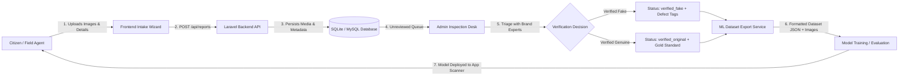

# Fake9ja Sentinel — Single Source of Truth (SSOT)
**Version:** 2.0.0  
**Last Updated:** October 2026  
**Status:** Active Canonical Specification  
**Architecture Pattern:** Decoupled Monorepo (`frontend/` + `backend/` + `ml-pipeline/`)

---

## 1. Executive Summary & Strategic Intent

### 1.1 The Problem
In Nigeria and broader West African consumer markets, counterfeit products present a critical hazard across essential sectors:
- **Pharmaceuticals & Healthcare:** Adulterated antimalarials (e.g., Artemether/Lumefantrine), fake antibiotics, diluted cough syrups.
- **Cosmetics & Skincare:** Unregistered lotions, skin-lightening creams containing banned hydroquinone, mercury, and toxic steroids.
- **Automotive & Industrial:** Cloned motor engine oils (e.g., counterfeit Total Quartz), fake brake pads, re-labeled spark plugs.
- **Packaged Food & Beverages:** Expired baby formulas with double laser dates, adulterated milk, fake spirits and wines.
- **Electronics & Accessories:** Substandard power banks with explosive lithium cells, fake chargers, cloned consumer electronics.

Existing verification channels (SMS scratch codes, sporadic regulator raids) are fragmented, reactive, and often inaccessible at the point of sale.

### 1.2 The Platform Mission
**Fake9ja Sentinel** is a citizen-powered intelligence and safety verification network. It serves a dual purpose:
1. **Immediate Citizen Protection:** Free, lightning-fast public reporting, hotspot radar tracking, brand monitoring, and incident verification.
2. **AI/ML Model Training Pipeline (Primary Core Intent):** Systematically gathering, curating, and annotating high-fidelity multimodal data (images, barcodes, batch codes, packaging seals, retail pricing delta, and geographic hotspots) to train state-of-the-art computer vision and multimodal models capable of **distinguishing original and fake products in real-world African market conditions**.

---

## 2. System Architecture Overview

The repository is structured as a senior-grade, decoupled Monorepo to separate concerns cleanly between client experiences, API services, and machine learning data pipelines.

```
fake9ja/
├── SOURCE_OF_TRUTH.md         # Canonical platform architecture & specifications
├── GUIDE.md                   # Developer & data annotator operational guide
├── README.md                  # Monorepo overview and root run scripts
├── AGENTS.md                  # Engineering guidelines for AI agents & contributors
├── package.json               # Root monorepo orchestrator (dev, build, lint scripts)
├── netlify.toml               # Netlify edge deployment configuration
│
├── frontend/                  # React 19 Client & Data Collection SPA
│   ├── src/
│   │   ├── components/        # Radix UI, layout, radar, camera, and incident cards
│   │   ├── hooks/             # Custom React hooks (theme, offline state, queries)
│   │   ├── lib/               # api.ts (resilient client), utils, types
│   │   ├── routes/            # TanStack Router pages (index, report, track, community, admin)
│   │   ├── router.tsx         # Router configuration
│   │   ├── styles.css         # Tailwind CSS styling tokens
│   │   └── main.tsx           # React entry point
│   ├── public/                # Static assets, category sample imagery, icons
│   ├── index.html             # HTML5 SPA host
│   ├── vite.config.ts         # Vite bundler configuration & local API reverse proxy
│   ├── tsconfig.json          # TypeScript strict compiler config
│   └── package.json           # Frontend dependencies & build scripts
│
├── backend/                   # Laravel 12 Headless REST API & Storage
│   ├── app/
│   │   ├── Http/Controllers/  # Api/Fake9jaController, Api/MlDatasetController
│   │   └── Models/            # Report, ReportMedia, MarketHotspot, BrandWatch, VideoTestimony
│   ├── database/
│   │   ├── migrations/        # Reports, media, hotspots, brand watches, testimonies
│   │   └── seeders/           # Realistic seed records for Nigerian commerce
│   ├── routes/
│   │   ├── api.php            # Headless REST endpoints (/api/reports, /api/ml/...)
│   │   └── web.php            # Storage proxy and fallback handlers
│   ├── storage/app/public/    # Uploaded citizen evidence files (images/videos)
│   ├── artisan                # Laravel CLI runner
│   ├── composer.json          # PHP 8.2+ dependencies
│   └── .env.example           # Environment template (SQLite / MySQL)
│
└── ml-pipeline/               # Anti-Counterfeit Machine Learning Foundation
    ├── DATASET_GUIDELINES.md  # Standard operating procedures for photo capture & labeling
    ├── dataset_schema.json    # JSON schema definition for model training exports
    └── export_dataset.py      # Python utility to download & format verified pairs (Original vs Fake)
```

---

## 3. Data Gathering Strategy for the Anti-Counterfeit ML Model

### 3.1 The Multimodal Challenge
Counterfeit goods in emerging markets cannot be detected by raw visual classification alone. Distinctions often rely on:
1. Micro-typography differences (font weight, kerning, spelling errors).
2. Hologram reflectivity and tamper-evident seal integrity.
3. Inkjet vs laser batch code stamping textures.
4. Barcode/QR validation against official manufacturer catalogs.
5. Price divergence (an authentic product rarely sells at an 80% discount).

### 3.2 The 5-Point Image Modality Requirement
Every report submitted through the citizen wizard and verified by the admin desk strives to capture up to 5 distinct photographic angles:

| Modality Key | Description | ML Training Utility |
|---|---|---|
| `front_packaging` | Full front view of box, bottle, or blister pack | Overall brand identity, logo geometry, color balance |
| `seal_hologram` | Close-up of hologram sticker, tear strip, cap seal | Hologram diffraction patterns, tamper mark classification |
| `barcode_qr` | Sharp view of 1D barcode (EAN-13, UPC) or 2D QR | OCR decoding, synthetic code spoofing detection |
| `batch_expiry` | Laser stamp / inkjet date and batch code | Character recognition, font tampering, date logic checks |
| `back_ingredients` | Back panel with regulatory marks (NAFDAC/SON) | Regulatory number verification, legal text spelling inspection |

### 3.3 Data Ingestion Pipeline & Model Flywheel



### 3.4 Target ML Models Fed by this Dataset
1. **Model A: Binary Authenticity Classifier (ViT / ResNet50)**
   - Inputs: Normalized front and seal images + Category embedding.
   - Output: Probability score `P(is_counterfeit) ∈ [0.0, 1.0]`.
2. **Model B: Defect & Tamper Localization (YOLOv11-OBB)**
   - Inputs: High-resolution packaging photographs.
   - Output: Bounding boxes around defects (e.g., `blurred_batch_code`, `fake_hologram`, `altered_expiry`, `spelling_typo`).
3. **Model C: Multimodal Verification Engine**
   - Combines Vision score + OCR text matching + Barcode verification + Price anomaly ratio:
   $$\text{Risk Score} = w_1 \cdot \text{VisionRisk} + w_2 \cdot \text{PriceAnomaly} + w_3 \cdot \text{BarcodeMismatch}$$

---

## 4. API Endpoints Specification

All backend endpoints are prefixed with `/api` and return standardized JSON responses.

### 4.1 Public Citizen Intelligence (No Auth Required)
- `GET /api/reports`  
  *Query params:* `category`, `status`, `state`, `search`  
  *Response:* `{ data: ReportItem[] }`
- `POST /api/reports`  
  *Payload:* Multi-part form data with product info, purchase location, price, and media files.  
  *Response:* `{ success: true, reference_id: string, report: ReportItem }`
- `GET /api/reports/track/{referenceId}`  
  *Response:* Detailed incident status, timeline, reviewer notes, and verification outcome.
- `GET /api/hotspots`  
  *Response:* Geocoded market risk heatmaps (Balogun, Sabon Gari, Computer Village, Onitsha Main Market, etc.).
- `GET /api/public-stats`  
  *Response:* Total reports, verified counterfeits neutralized, high-risk hot zones, active brand sentinels.
- `POST /api/brand-watches`  
  *Payload:* Brand protection and manufacturer alert registrations.

### 4.2 Admin Review & Data Labeling Desk
- `POST /api/admin/login`  
  *Payload:* `{ email, password }`  
  *Default Dev Credentials:* `admin@fake9ja.ng` / `admin123`
- `GET /api/admin/stats`  
  *Response:* Breakdown of pending triage, verified fake, verified original, and priority queues.
- `PATCH /api/admin/reports/{id}/status`  
  *Payload:* `{ status: "verified_fake" | "verified_original" | "under_review" | "escalated", reviewer_note: string, risk_level: string }`
- `DELETE /api/admin/reports/{id}`  
  *Deletes invalid or malicious entries.*

### 4.3 Machine Learning Dataset Ingestion & Export
- `GET /api/ml/dataset/export`  
  *Query params:* `status=verified_only`, `category=Medicines`, `format=json|csv`  
  *Response:* Filtered training dataset mapping image assets to verified ground-truth labels and defect annotations.

---

## 5. Technology Stack Standards

### 5.1 Frontend Architecture
- **Language & Runtime:** TypeScript 5.8+ / Node.js 20+
- **Framework & Routing:** React 19 / TanStack Router (code-split, type-safe routes)
- **Styling & UI Kit:** Tailwind CSS 4, Radix UI Primitives, Lucide React icons, Framer Motion
- **State & Resilience:** TanStack Query for cache invalidation, LocalStorage optimistic fallback in `src/lib/api.ts` guaranteeing **zero UI crashes** even when backend is offline.

### 5.2 Backend Architecture
- **Language & Framework:** PHP 8.2+ / Laravel 12
- **Persistence:** SQLite for zero-configuration local dev; MySQL 8 / PostgreSQL for cloud staging.
- **Media Ingestion:** Validated image/video storage in `storage/app/public/evidence` with hashed paths and public CORS headers.
- **Security:** CSRF exemptions on stateless API routes, sanitized input validation, file extension and MIME type verification.

---

## 6. Environment Configurations

### Frontend (`frontend/.env`)
```ini
VITE_API_URL=/api
VITE_STORAGE_URL=/storage
VITE_ENABLE_ANALYTICS=false
```

### Backend (`backend/.env`)
```ini
APP_NAME=Fake9jaSentinel
APP_ENV=local
APP_KEY=base64:Fake9jaDevelopmentKeyGeneratedByArtisan=
APP_DEBUG=true
APP_URL=http://127.0.0.1:8000

DB_CONNECTION=sqlite
# DB_DATABASE=database/database.sqlite

SESSION_DRIVER=cookie
QUEUE_CONNECTION=sync
FILESYSTEM_DISK=public
```

---

## 7. Operational Commandments for Senior Engineers
1. **Preserve Data Fidelity:** Never downscale or aggressively compress uploaded evidence images below $1200\times1200$ resolution; high resolution is imperative for training optical defect detectors.
2. **Never Break Fallbacks:** The frontend must always display seeded reports and provide smooth submission UX even if the local PHP backend is not yet spun up.
3. **Labels are Ground Truth:** Marking a report as `verified_fake` or `verified_original` directly feeds the training corpus. Always require a `reviewer_note` detailing the specific failure point or confirmation certificate.
4. **Strict Module Separation:** Do not bleed PHP/Laravel dependencies into the `frontend/` directory, nor bundle Node build artifacts inside `backend/`. Keep the boundaries clean and reproducible.
